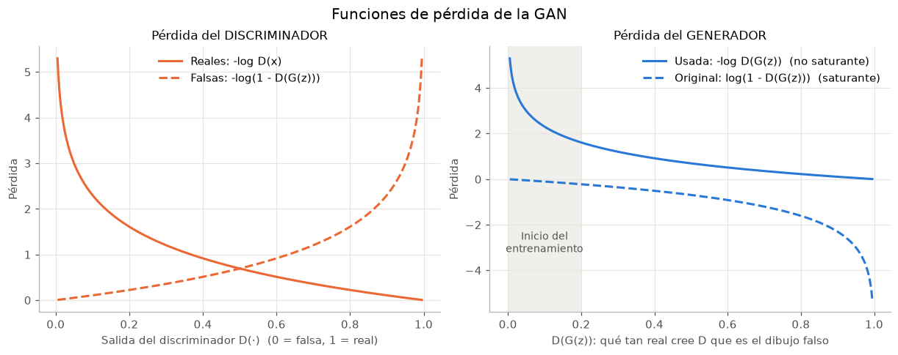
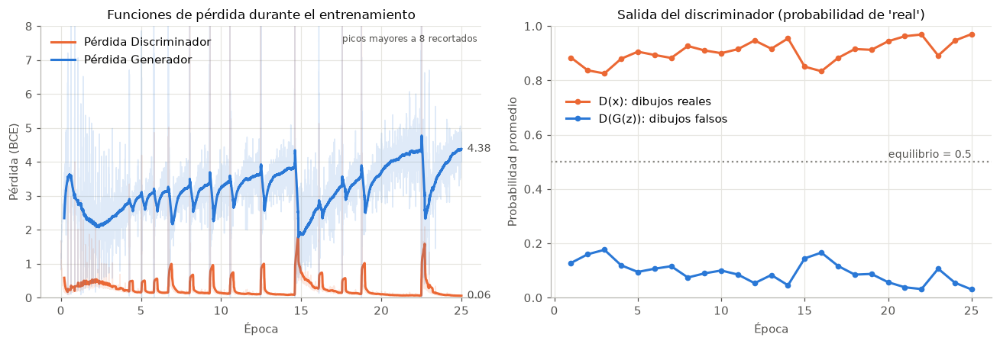
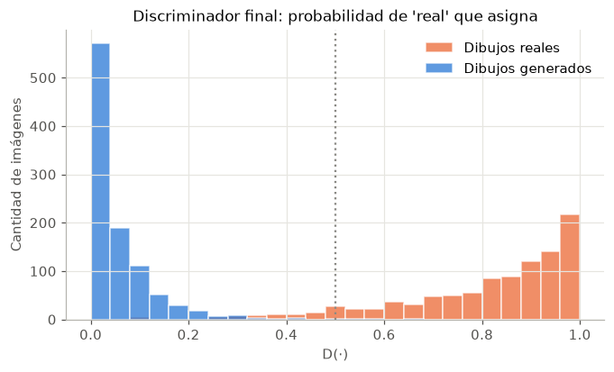
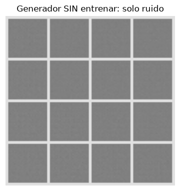
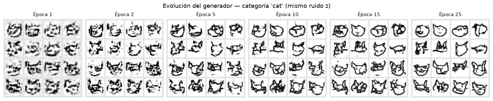
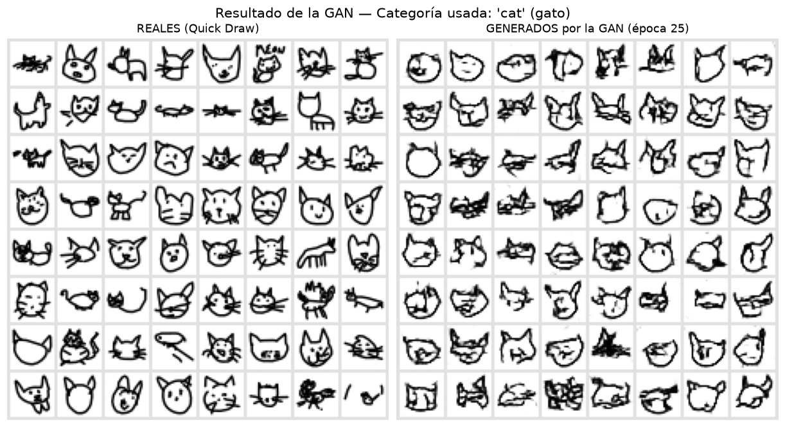
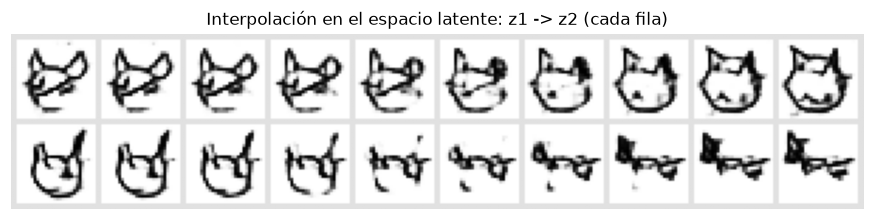

# GAN con Google Quick Draw: Red Generadora vs. Red Discriminadora

Proyecto que entrena una **Red Generativa Adversaria (GAN)** para que aprenda a dibujar
bocetos de la categoría **`cat` (gato)** del conjunto de datos
[Google Quick, Draw!](https://quickdraw.withgoogle.com/data). Explica los parámetros de
las dos redes neuronales, las funciones de pérdida, los valores que toman durante el
entrenamiento y el resultado final.

> **Categoría usada: `cat` (gato)**, 30 000 dibujos de 28x28 píxeles tomados al azar de los
> 123 202 disponibles en Quick Draw.
>
> **Página web del proyecto:** https://gan-quickdraw-usta.web.app

---

## 1. Estructura del proyecto

```
GAN-QuickDraw/
├── gan_quickdraw.py        Código completo y comentado (se ejecuta como script)
├── GAN_QuickDraw.ipynb     El mismo código en notebook, ya ejecutado y con las salidas
├── requirements.txt        Librerías necesarias
├── README.md               Este documento
├── exportar_web.py         Pasa el modelo entrenado a la página web (docs/modelo/)
├── ver_pagina.bat          Doble clic: abre la página en http://localhost:8000
├── docs/                   Página web del proyecto (GitHub Pages)
│   ├── index.html          Página con scroll cinematográfico
│   ├── js/red.js           Las dos redes ejecutadas en JavaScript
│   ├── js/trabajador.js    Web Worker para no trabar el scroll
│   ├── js/app.js           Dibujos, gráficas y visor de código
│   └── modelo/             Pesos entrenados (float16) e historial
├── datos/
│   └── cat.npy             Dibujos de Quick Draw (se descarga solo; no se sube a GitHub)
└── resultados/             Lo que genera el entrenamiento
    ├── 01_datos_reales.png
    ├── 02_generador_sin_entrenar.png
    ├── 03_funciones_de_perdida.png
    ├── 04_valores_entrenamiento.png
    ├── 05_evolucion_generador.png
    ├── 06_resultado_gan.png
    ├── 07_interpolacion_latente.png
    ├── 08_salida_discriminador.png
    ├── evolucion.gif
    ├── historial_entrenamiento.csv   Valores de G y D por época
    ├── reporte_valores.txt           Todo lo impreso: capas, parámetros y pesos
    ├── resumen.json
    ├── generador.pth                 Pesos entrenados del generador
    └── discriminador.pth             Pesos entrenados del discriminador
```

## 2. Cómo ejecutarlo

```powershell
cd GAN-QuickDraw
py -m venv .venv
.venv\Scripts\activate
pip install torch --index-url https://download.pytorch.org/whl/cpu
pip install numpy matplotlib pillow ipykernel nbconvert

python gan_quickdraw.py
```

También se puede abrir `GAN_QuickDraw.ipynb` en VS Code, Jupyter o Google Colab y
ejecutar las celdas en orden. En CPU el entrenamiento tarda unos 20 minutos; con GPU
(CUDA) el código la usa automáticamente.

Para probar otra categoría basta con cambiar `CATEGORIA` en la sección 1 del código
(por ejemplo `"apple"`, `"star"` o `"fish"`). El archivo se descarga solo.

## 3. ¿Dónde está cada cosa en el código?

| Qué | Dónde (en `gan_quickdraw.py`) |
|---|---|
| Categoría usada (`CATEGORIA = "cat"`) | Sección 1, línea 69 |
| **Definición de la red Generadora** (`class Generador`) | Sección 3, línea 246 |
| **Definición de la red Discriminadora** (`class Discriminador`) | Sección 4, línea 305 |
| **Creación de la red Generadora** (`G = Generador(...)`) | Sección 5, línea 358 |
| **Creación de la red Discriminadora** (`D = Discriminador(...)`) | Sección 5, línea 364 |
| Función de pérdida del discriminador | Sección 6, línea 481 |
| Función de pérdida del generador | Sección 6, línea 493 |
| Optimizadores (uno por red) | Sección 7, línea 530 |
| Ciclo de entrenamiento (paso D y paso G) | Sección 8, línea 571 |

Cada uno de esos puntos está marcado en el código con un recuadro de comentarios
(`AQUÍ SE DEFINE...` / `>>> AQUÍ SE CREA...`).

---

## 4. Red neuronal GENERADORA (G)

Convierte **ruido aleatorio en un dibujo**. Recibe un vector `z` de 100 números
(distribución normal) y lo va agrandando hasta formar una imagen de 28x28.

```
z (100) → Linear → 128×7×7 → ConvTranspose → 64×14×14 → ConvTranspose → 1×28×28 → Tanh
```

| Capa | Tipo | Forma de salida | Parámetros |
|---|---|---|---:|
| (entrada) | ruido `z` | [100] | |
| capa1_lineal | Linear (sin sesgo) | [6272] | 627 200 |
| capa1_batchnorm | BatchNorm1d | [6272] | 12 544 |
| capa1_relu | ReLU | [6272] | 0 |
| redimensionar | Unflatten | [128, 7, 7] | 0 |
| capa2_deconv | ConvTranspose2d (k=4, s=2) | [64, 14, 14] | 131 072 |
| capa2_batchnorm | BatchNorm2d | [64, 14, 14] | 128 |
| capa2_relu | ReLU | [64, 14, 14] | 0 |
| capa3_deconv | ConvTranspose2d (k=4, s=2) | [1, 28, 28] | 1 025 |
| salida_tanh | Tanh | [1, 28, 28] | 0 |
| **Total** | | | **771 969** |

Parámetros y por qué se eligieron:

- **Dimensión latente = 100:** tamaño del vector de ruido. Cada `z` distinto produce un gato distinto.
- **ConvTranspose2d con kernel 4, stride 2, padding 1:** duplica el alto y el ancho en cada capa (7 → 14 → 28).
- **BatchNorm:** normaliza las activaciones de cada lote y estabiliza el entrenamiento.
- **ReLU** en las capas ocultas y **Tanh** a la salida, para que los píxeles queden en [-1, 1], el mismo rango de los datos reales.
- **Learning rate 0.0002 y Adam con beta1 = 0.5**, valores recomendados en el artículo DCGAN.

## 5. Red neuronal DISCRIMINADORA (D)

Es un **clasificador binario**: recibe una imagen y devuelve la probabilidad de que sea
un dibujo **real** de Quick Draw (1 = real, 0 = falsa). Hace el camino inverso al
generador: reduce la imagen hasta un solo número.

```
1×28×28 → Conv → 64×14×14 → Conv → 128×7×7 → Linear → 1 → Sigmoid → P(real)
```

| Capa | Tipo | Forma de salida | Parámetros |
|---|---|---|---:|
| (entrada) | imagen | [1, 28, 28] | |
| capa1_conv | Conv2d (k=4, s=2) | [64, 14, 14] | 1 088 |
| capa1_leakyrelu | LeakyReLU(0.2) | [64, 14, 14] | 0 |
| capa2_conv | Conv2d (k=4, s=2, sin sesgo) | [128, 7, 7] | 131 072 |
| capa2_batchnorm | BatchNorm2d | [128, 7, 7] | 256 |
| capa2_leakyrelu | LeakyReLU(0.2) | [128, 7, 7] | 0 |
| aplanar | Flatten | [6272] | 0 |
| capa3_lineal | Linear | [1] | 6 273 |
| salida_sigmoid | Sigmoid | [1] | 0 |
| **Total** | | | **138 689** |

Parámetros y por qué se eligieron:

- **Conv2d con kernel 4, stride 2:** extrae rasgos (trazos, orejas, bigotes) y reduce la imagen a la mitad en cada capa (28 → 14 → 7).
- **LeakyReLU con pendiente 0.2:** a diferencia de ReLU, deja pasar un gradiente pequeño en los valores negativos, así el generador sigue recibiendo información para aprender.
- **Sin BatchNorm en la primera capa**, otra recomendación del artículo DCGAN.
- **Sigmoid** a la salida, para convertir el puntaje en una probabilidad.
- El discriminador tiene **menos parámetros** que el generador (138 mil contra 772 mil). Clasificar es más fácil que dibujar, y si D fuera mucho más fuerte, G no lograría aprender.

## 6. Funciones de pérdida

La GAN es un juego **minimax** entre las dos redes (curso de Google y Goodfellow et al., 2014):

$$\min_G \max_D \; \mathbb{E}_x[\log D(x)] + \mathbb{E}_z[\log(1 - D(G(z)))]$$

- `D(x)` es la probabilidad que el discriminador da a un dibujo **real**. D quiere que sea 1.
- `D(G(z))` es la probabilidad que da a un dibujo **falso**. D quiere que sea 0 y G quiere que sea 1.

Cada red tiene su propia pérdida, calculada con **entropía cruzada binaria (BCE)**:

| Red | Fórmula | En el código | Baja cuando... |
|---|---|---|---|
| Discriminador | $L_D = -[\log D(x) + \log(1 - D(G(z)))]$ | `BCE(D(x), 1) + BCE(D(G(z)), 0)` | acierta con los reales y con los falsos |
| Generador | $L_G = -\log D(G(z))$ | `BCE(D(G(z)), 1)` | D cree que los dibujos falsos son reales |

Para el generador se usa la **pérdida minimax modificada (no saturante)** que recomienda
el curso de Google. Al comienzo del entrenamiento D rechaza los dibujos falsos con
facilidad (`D(G(z))` cerca de 0). En esa zona la pérdida original `log(1 - D(G(z)))` es
casi plana y casi no da gradiente, mientras que `-log D(G(z))` es muy inclinada y sí
le dice al generador cómo mejorar:



El curso de Google también describe la **pérdida de Wasserstein** (WGAN). Este
proyecto usa la pérdida minimax porque es la estándar y la más fácil de explicar.

### Entrenamiento alternado

En cada lote de 128 imágenes:

1. **Paso D:** el discriminador ve 128 dibujos reales (etiqueta 1) y 128 falsos (etiqueta 0), y se actualizan **solo** los pesos de D. Los falsos se pasan con `.detach()` para no tocar G.
2. **Paso G:** el generador crea dibujos, D los evalúa y se actualizan **solo** los pesos de G para que D los marque como reales.

## 7. Hiperparámetros

| Parámetro | Valor |
|---|---|
| Categoría Quick Draw | `cat` |
| Imágenes de entrenamiento | 30 000 |
| Tamaño de imagen | 28x28, 1 canal, escalada a [-1, 1] |
| Dimensión del ruido `z` | 100 |
| Tamaño de lote | 128 (234 lotes por época) |
| Épocas | 25 |
| Optimizador (G y D) | Adam, lr = 0.0002, beta1 = 0.5, beta2 = 0.999 |
| Inicialización de pesos | Normal(0, 0.02) |
| Semilla | 42 |

---

## 8. Valores del generador y del discriminador

### Valores durante el entrenamiento

En cada época se registran cuatro valores (todos están en `resultados/historial_entrenamiento.csv`):

- **Pérdida D:** qué tan mal clasifica el discriminador. Si hubiera equilibrio perfecto sería unos 1.39 (= 2·ln 2).
- **Pérdida G:** qué tan mal engaña el generador. Con equilibrio sería unos 0.69 (= ln 2).
- **D(x):** probabilidad promedio que D da a los dibujos **reales**.
- **D(G(z)):** probabilidad promedio que D da a los dibujos **generados**.

| Época | Pérdida D | Pérdida G | D(x) | D(G(z)) |
|---:|---:|---:|---:|---:|
| 1 | 0.341 | 3.053 | 0.884 | 0.128 |
| 2 | 0.434 | 2.425 | 0.837 | 0.160 |
| 5 | 0.244 | 2.845 | 0.906 | 0.095 |
| 10 | 0.323 | 3.069 | 0.900 | 0.100 |
| 15 | 0.577 | 3.159 | 0.850 | 0.145 |
| 20 | 0.123 | 3.430 | 0.944 | 0.057 |
| 25 | 0.064 | 4.245 | 0.970 | 0.030 |



**Cómo leer estos valores:**

- En teoría, si el generador fuera perfecto, D(x) y D(G(z)) quedarían en **0.5**: el discriminador no podría distinguir y tendría que adivinar.
- En la práctica **el discriminador va ganando**: al final da 0.97 a los reales y 0.03 a los generados. Por eso la pérdida de D baja (0.06) y la de G sube (4.2). Es el comportamiento más común en una GAN, porque clasificar es más fácil que dibujar.
- Que D gane **no significa que G no haya aprendido**: los dibujos generados son gatos reconocibles (sección 9). D solo sigue encontrando detalles finos que los delatan, como trazos un poco borrosos.
- Los **picos** de la gráfica de pérdidas son momentos en que una red se adelanta a la otra y luego se recupera. Esta oscilación es normal en el entrenamiento adversario.

### Valores de los pesos: antes y después de entrenar

Todos los pesos empiezan con media 0 y desviación 0.02. Al entrenar, cada capa se
ajusta a su función. Extracto de `resultados/reporte_valores.txt`:

| Red | Parámetro | Desv. inicial | Desv. final | Rango final |
|---|---|---:|---:|---|
| G | capa1_lineal.weight [6272, 100] | 0.0200 | 0.0266 | -0.124 a 0.121 |
| G | capa2_deconv.weight [128, 64, 4, 4] | 0.0200 | 0.0266 | -0.177 a 0.205 |
| G | capa3_deconv.weight [64, 1, 4, 4] | 0.0191 | 0.1044 | -0.381 a 0.253 |
| D | capa1_conv.weight [64, 1, 4, 4] | 0.0201 | 0.0222 | -0.072 a 0.092 |
| D | capa2_conv.weight [128, 64, 4, 4] | 0.0200 | 0.0243 | -0.137 a 0.143 |
| D | capa3_lineal.weight [1, 6272] | 0.0200 | 0.0444 | -0.187 a 0.236 |

La capa que más cambia es la última del generador (`capa3_deconv`), que es la que
"pinta" los píxeles del trazo final: su desviación pasa de 0.02 a 0.10.

### Opinión final del discriminador

Con 1000 dibujos reales y 1000 generados, el discriminador entrenado da en promedio
**0.81** a los reales y **0.06** a los generados:



## 9. Resultado de la GAN (categoría: `cat`)

**Categoría usada: `cat` (gato) de Google Quick Draw.**

Antes de entrenar, el generador solo produce ruido:



Evolución del generador con **el mismo ruido `z`** en cada época. En la época 1 hay
manchas, hacia la época 5 aparecen contornos de cabeza y orejas, y de la época 15 en
adelante los trazos son más limpios:



Resultado final, con dibujos reales al lado para comparar. La GAN aprendió los rasgos
típicos de un gato de Quick Draw: cabeza redonda, dos orejas en punta, ojos y bigotes.
Igual que en los datos reales, hay variedad: caras de frente, gatos de cuerpo entero y
dibujos de lado.



Interpolación en el espacio latente: al pasar poco a poco de un vector `z` a otro, el
dibujo cambia de forma gradual. Eso indica que el generador aprendió un espacio continuo
de "gatos" y no memorizó imágenes sueltas:



La animación `resultados/evolucion.gif` muestra las 25 épocas seguidas.

### Resumen

| | Valor |
|---|---|
| Categoría | `cat` (gato), Google Quick Draw |
| Parámetros de la red Generadora | 771 969 |
| Parámetros de la red Discriminadora | 138 689 |
| Pérdida D / Pérdida G (época 25) | 0.064 / 4.245 |
| D(x) / D(G(z)) (época 25) | 0.970 / 0.030 |
| Tiempo de entrenamiento | unos 16 minutos en CPU |

---

## 10. Página web

La carpeta `docs/` tiene una página que presenta **solo los puntos de la tarea**, numerados
igual que en el enunciado. El modelo entrenado corre en el navegador, sin servidor:

1. **Red Generadora:** escena con los valores reales de cada capa (ruido z, mapas de activación, dibujo) y tabla de parámetros.
2. **Red Discriminadora:** escena con sus mapas de activación y la probabilidad de «real», y tabla de parámetros.
3. **Funciones de pérdida:** fórmulas (minimax, L_D, L_G, BCE) y la gráfica de cada una.
4. **Código:** dónde se define y dónde se crea cada red, con el código comentado.
5. **Valores:** el scroll recorre las 25 épocas; gráficas de D(x), D(G(z)) y pérdidas; pesos antes y después.
6. **Resultado:** dibujos reales contra generados, con la categoría usada (**cat**).

Está hecha con el skill **scroll-cinematic-landing** (estilo Apple, scroll cinematográfico,
sin librerías externas) y está pensada para escritorio (900 px de ancho o más).

`exportar_web.py` guarda los pesos en `float16` y funde cada BatchNorm con su capa;
`docs/js/red.js` ejecuta las redes con JavaScript. Se comparó con PyTorch y la
diferencia máxima es de 0.001 en los píxeles.

Para verla en el computador: **doble clic en `ver_pagina.bat`**, que abre
http://localhost:8000 (no cierres la ventana negra mientras la ves). También se puede
desde la carpeta del proyecto con `py -m http.server 8000 --directory docs`; en Windows usa
`py`, porque `python` puede abrir la Microsoft Store.

Está publicada en **Firebase Hosting**: https://gan-quickdraw-usta.web.app (proyecto
`gan-quickdraw-usta`). Para volver a publicarla después de un cambio:
`firebase deploy --only hosting`.

---

## Referencias

- Google for Developers, *Redes generativas adversarias*: https://developers.google.com/machine-learning/gan?hl=es-419
- GAN Lab, visualización interactiva de una GAN: https://poloclub.github.io/ganlab/
- Google, *The Quick, Draw! Dataset*: https://quickdraw.withgoogle.com/data
- Goodfellow et al. (2014), *Generative Adversarial Nets*.
- Radford et al. (2015), *Unsupervised Representation Learning with Deep Convolutional GANs (DCGAN)*.
